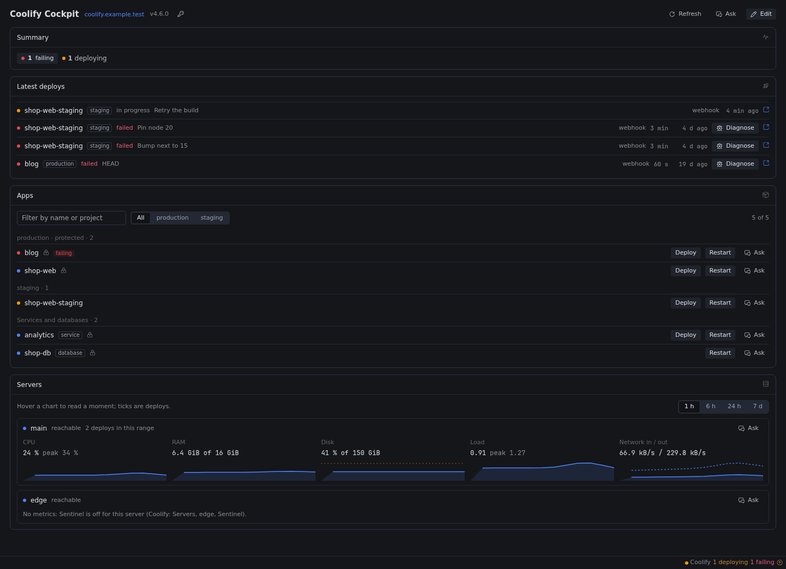
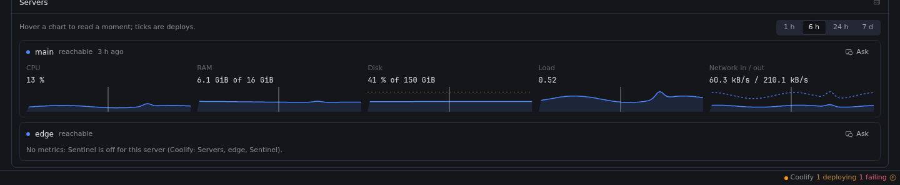
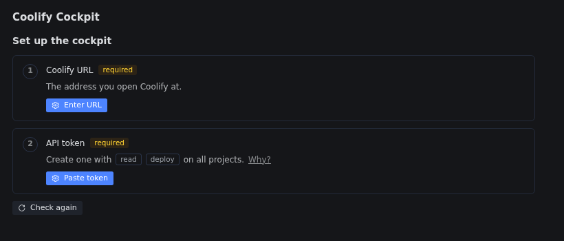
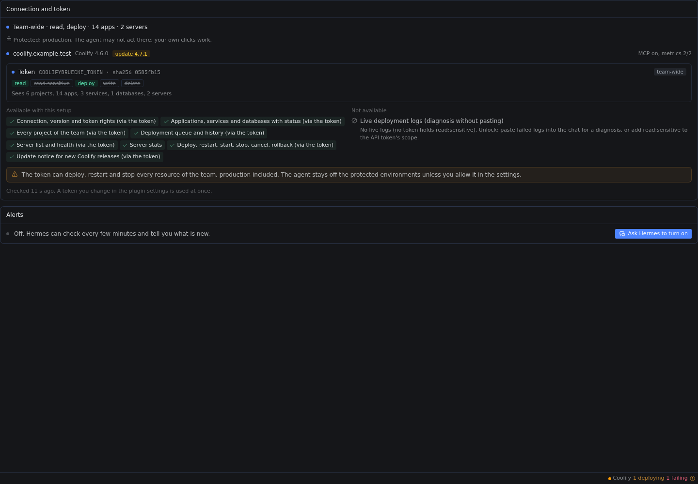

# Coolifybrücke

See what needs you across your [Coolify](https://coolify.io) instance, deploy with your approval,
and let Hermes explain failed deploys.



Version 0.2.6. MIT. Needs Hermes 0.23.0 or later. A Studio Luftbrücke
Hermes plugin. The full reference is in [docs/guide.md](docs/guide.md).

## What it does

- **What needs you, first.** Failed deploys, unhealthy apps, env changes and branch commits that
  are not deployed yet, and servers under pressure, in one list. The page, the status-bar chip, the
  agent and the alert job all read it.
- **Every action asks first.** Deploy, restart, stop or roll back from the page or the chat. The
  agent's actions wait for Hermes' approval prompt, and runs where no one can answer are refused
  before any request reaches Coolify. Protected environments (`production` by default) stay off
  limits for the agent unless you allow it.
- **Failed deploys, explained.** Paste a failed log and Hermes classifies it against a catalogue
  of eleven common self-hosting failures, with the evidence lines and a likely fix. Plain pattern
  matching, no model call.
- **Your token is the permission model.** A read-only token gives a read-only cockpit. A token
  limited to staging can act only on staging. The plugin shows what your setup unlocks and why the
  rest is not available.
- **Your layout, edited by you or Hermes.** Presets, widgets and server charts with deploy ticks.
  The page and the agent edit the same layout, and alerts can run while Desktop is closed.



## Install and update

The plugin has two halves. The tools, routes and alerts run where the Hermes backend runs. Hermes
Desktop loads the Coolifybrücke page and the settings page from the computer it runs on, never from a
Hermes on a server. With Hermes on a server, install and update the plugin in both places, on the
same version. With Hermes and Desktop on one computer, one install covers both.

| Where | Install | Update |
| --- | --- | --- |
| Server: tools, routes, alerts | `hermes -p <profile> plugins install https://github.com/studioluftbruecke/hermes-coolifybruecke --enable` | `hermes -p <profile> plugins update coolifybruecke` |
| Desktop computer: Coolifybrücke page and settings page | `hermes plugins install https://github.com/studioluftbruecke/hermes-coolifybruecke` | `hermes plugins update coolifybruecke` |

- After either step on the Desktop computer: **Capabilities → Plugins → Rescan**. A new install's
  Desktop half arrives switched off; switch on **coolifybruecke** there.
- No Hermes on the Desktop computer: **Capabilities → Plugins → Install from Git** with the URL,
  **Agent plugin** and **Desktop UI** both selected. To update, the same with **Advanced → Force
  reinstall**. Desktop's **Update** button updates the server only.
- After an update on the server, Desktop chats and the plugin's routes keep the old code: in
  **Capabilities → Plugins**, switch **Agent in <profile>** off and on, then start a new chat.
- Same version in both places? Compare the Version column of `hermes plugins list` on the Desktop
  computer and `hermes -p <profile> plugins list` on the server.
- The sidebar switch and position on the plugin's settings page are kept per Desktop, so a second
  computer starts with the defaults.
- Hermes scans every plugin from outside its catalog before it installs it and prints "Warning:
  custom (unreviewed) source". This plugin passes the scan, so `--force` is not needed. `--ref`
  with a full commit SHA pins the install.

## Upgrading from Coolify Cockpit 0.1.0

0.2.0 renames the plugin to Coolifybrücke: plugin `coolifybruecke`, settings `COOLIFYBRUECKE_*`,
command `hermes coolifybruecke`, skill `coolifybruecke:coolifybruecke`. It does not read the old
`COOLIFY_COCKPIT_*` settings, so you enter the URL and the token again under the new names. Your
layout and your notebook (`COOLIFY.md`) come along: on first use 0.2.0 copies the files of
`plugin-data/coolify-cockpit/` into `plugin-data/coolifybruecke/` and leaves the old folder as it is.

Run these where 0.1.0 is installed (on the server with `-p <profile>`, on the Desktop computer
without):

```bash
hermes -p <profile> plugins remove coolify-cockpit
hermes -p <profile> plugins install https://github.com/studioluftbruecke/hermes-coolifybruecke --enable
```

`hermes plugins update coolify-cockpit`, the update command of 0.1.0, does not move you to 0.2.0.
Hermes stops with "The updated plugin changed its installed name; reinstall it explicitly." and
keeps 0.1.0 installed and enabled. Run the two commands above instead.

Then:

1. Enter the Coolify URL and the API token again in **Settings → Plugins → Coolifybrücke** (or as
   the [guide](docs/guide.md#configure-without-hermes-desktop) shows, with the new names).
2. If alerts were on: `hermes -p <profile> coolifybruecke alerts on`. It replaces the 0.1.0 job and
   deletes the old `coolify-cockpit-alerts.py`, so one job named "Coolifybrücke alerts" remains.
3. If you made a morning digest from the blueprint, delete that job and create it once more from
   the blueprint "Coolify morning digest": the old job names the old skill.
4. In Hermes Desktop: **Capabilities → Plugins → Rescan**, switch on **coolifybruecke**, and open
   **Coolifybrücke** in the sidebar. A tab still open on the old page shows nothing until you
   reload Desktop.
5. Restart the gateway (`hermes gateway restart`, or quit and reopen Hermes Desktop when Desktop
   runs it). A gateway that loaded 0.1.0 keeps its hooks and its `@coolify:` reference until then,
   and that old reference finds no URL under the old setting names.

## First use

1. In Coolify, open **Settings → Advanced** and enable **API access** and the **MCP server**.
   Then create a token in **Keys & Tokens → API tokens** with `read` and `deploy` on all projects.
   Leave `read:sensitive`, `write` and `delete` off.
2. In Hermes Desktop, open **Coolifybrücke** in the sidebar. Click **Enter URL**, then **Paste
   token**. The page picks up the saved values within a few seconds and shows one result line, for
   example "Team-wide · read, deploy · 28 apps · 2 servers".
3. Ask Hermes "what needs me on Coolify?" in a new chat. Without Desktop, set the values as the
   [guide](docs/guide.md#configure-without-hermes-desktop) shows and ask the same question.



## Settings

All settings sit in **Settings → Plugins → Coolifybrücke**. Tokens go to the profile's `.env`,
the rest to its `config.yaml`.

| Setting | What it does | Default |
| --- | --- | --- |
| Coolify URL (`COOLIFYBRUECKE_URL`) | The address you open Coolify at | none |
| API token (`COOLIFYBRUECKE_TOKEN`) | Reads and acts. Recommended: `read` and `deploy`, all projects | none |
| Protected environments (`protected_environments`) | Comma-separated. The agent may not act there; your own clicks work. An empty or invalid value means `production` and produces a warning | `production` |
| Agent may act on protected environments (`agent_on_protected`) | On: each agent action there still asks you, naming the environment | off |
| Let the agent run actions (`agent_actions`) | Off: only your own clicks act | on |
| Disk warning at (%) (`disk_warn_percent`) | A server at or over this disk use needs attention | 85 |
| Memory warning at (%) (`memory_warn_percent`) | A server at or over this memory use needs attention | 90 |
| Check for Coolify updates (`check_updates`) | Compares your version with Coolify's release feed | on |
| Read-only token (`COOLIFYBRUECKE_READ_TOKEN`) | Optional. Only when the API token is limited to some projects: a team-wide `read` token shows servers and every app. Never acts | none |
| Git host token (`COOLIFYBRUECKE_GIT_TOKEN`) | Optional. Read-only, for "branch ahead" on private repositories without Forgebrücke | none |
| Git host of that token (`git_host`) | Where the git host token is sent. Empty: GitHub only | none |

Which token setups unlock what, and the tool list: [docs/guide.md](docs/guide.md).



## Safety and disclosures

- **`@coolify:` references send live data.** Any literal `@coolify:<value>` in a message you send
  is expanded with live data from your instance when the message is sent, and that data goes to
  your model provider with the message. This also happens when you paste text from an earlier
  reply that contains such a reference. In the composer a reference shows as plain text, not as a
  chip.
- **Disabling the plugin stops every action at once.** After `hermes plugins disable
  coolifybruecke`, Hermes keeps the hooks the plugin already registered (the approval check for
  `coolify_action`) until the gateway restarts. The tools are gone, so no action can run.
- **Approvals.** When the agent calls `coolify_action`, Hermes shows its approval prompt before
  anything is sent. Cron jobs, webhooks, the API server and single-query `hermes chat -q` or `-z`
  runs are refused without asking and without any request to Coolify. With Hermes' approvals off or
  `/yolo` on, Hermes approves without asking, as for every other gated tool. "Allow for this
  session" or "Always" on the prompt applies to that one action on that one resource (for example
  restarting `shop-api`): Hermes then runs it again without asking, for the session or for good,
  until you remove its entry (`plugin_rule:coolify_action:<action>:<uuid>`) from `command_allowlist`
  in the profile's `config.yaml`. Protected environments always ask. Details:
  [Actions and your approval](docs/guide.md#actions-and-your-approval).
- **Hermes compatibility.** The unattended-turn check imports the private Hermes module
  `gateway.session_finite`. If that import or check fails, the plugin treats the turn as unattended
  and refuses the write. An interrupted request whose outcome is unknown says that it may have run;
  it is never described as safe to repeat. A deployment id is checked before any request is sent.

## Disclosures

### Network calls

The plugin talks to the Coolify instance you configure, to Coolify's public release feed, and to
the git hosts of your applications' repositories for "branch ahead". It calls nothing else.
A remote `http://` Coolify address produces a warning because it sends tokens without encryption.
Use HTTPS outside localhost.

Every request to Coolify goes to `<your Coolify URL>/api/v1/...` or `<your Coolify URL>/mcp`, with
one of your Coolify tokens as a Bearer token. A request to Coolify never follows a redirect: when the
address answers with one (a login proxy in front of Coolify, for example), the call fails with an
error that names where the redirect pointed, and nothing is sent there.

| When | Requests |
| --- | --- |
| Token check (`coolify_capabilities`, the settings page's connection card and the page's availability check) | Per token: `GET /applications/<made-up id>`, `GET /applications/<made-up id>/logs`, `POST /deploy?uuid=<made-up id>`, `PATCH /applications/<made-up id>` and `DELETE /applications/<made-up id>` (the right probes, below); `GET /servers`, `GET /projects`, `GET /projects/{uuid}` per project, `GET /applications`, `GET /services` and `GET /databases`. Once: `GET /version` and an MCP `initialize` |
| Snapshot (`coolify_overview`, `@coolify:` references, the page and its status-bar chip, the alert tick) | `GET /servers` per token, `GET /applications`, `GET /services`, `GET /databases`, `GET /deployments` (the running queue), `GET /projects` and `GET /projects/{uuid}` per project (at most every 10 minutes, or when a new environment appears); MCP `tools/call` `get_server_metrics` per server with Sentinel metrics on and `list_deployments` twice (`status=finished`, `status=failed`); `GET /deployments/applications/{uuid}?skip=0&take=N` for at most 5 apps at the edge of those lists. About 30 requests on an instance with 23 projects the first time, 6 afterwards |
| Env check (every served snapshot, for the apps that are due) | `GET /applications/{uuid}/envs` per app, each at most every 10 minutes or after its next finished deployment; at most 6 per snapshot, 40 per alert tick. A 429 ends the round |
| Server charts of a longer range (the page) | MCP `get_server_metrics` per server with 360, 1440 or 10080 minutes, kept for 5, 10 or 30 minutes |
| Deployment history and details (`coolify_deployments`, the page) | `GET /deployments/applications/{uuid}?skip=0&take=N`, `GET /deployments/{uuid}` |
| Action list (the page) | With the API token only: the `deploy` probe |
| Failed-deploy log (`coolify_diagnose`, only with a `read:sensitive` token) | Two read-right probes against the made-up id, then `GET /deployments/{uuid}` |
| Actions (`coolify_action` after your approval, or your click in the page) | With the API token only: the `deploy` probe, `GET /applications`, `GET /services`, `GET /databases` or `GET /{kind}s/{uuid}` to find the target in that token's view (`GET /deployments/{uuid}` for `cancel`; that view is kept for 60 seconds, so the send after the page's check, or after your approval, reads nothing again), then one `POST` to `/deploy?uuid=...` (`&force=true` for a force rebuild), `/applications/{uuid}/restart`, `/services/{uuid}/restart`, `/databases/{uuid}/restart`, the same three with `/start` and `/stop` (`stop` always sends `docker_cleanup=false`), `/applications/{uuid}/rollback` or `/deployments/{uuid}/cancel` |

The snapshot and history code accepts only `GET` requests and the MCP tools `get_server_metrics`
and `list_deployments`; a guard refuses anything else. The env check reads only the timestamps of
the answer and stores no value.

**Coolify's API rate limit.** Coolify allows `API_RATE_LIMIT` requests per minute (200 by default) per Coolify user, shared by every token of that user, with 403 and 404 answers counted too (MCP calls are not). An open Coolifybrücke page with its chip used about 80 in the minute it opened, about 6 per minute while idle (56 in the minute of the 5-minute token check) and about 36 per minute while it followed a deployment, measured with 0.0.10 against an instance with 23 projects and 50 resources. 0.1.0 adds the deployment lists as MCP calls, which do not count, and the env checks, which do: each app once every 10 minutes, at most 6 per snapshot. When Coolify answers 429 the plugin says "Coolify is limiting API requests; try again in N s" and never retries on its own.

How rights are detected: Coolify checks a token's right before it looks up the resource, so the
right probes go to the made-up id `hermes-permission-probe-does-not-exist`. No real resource
receives a write from this check. Coolify answers "not found" for a right the token holds and
"missing permission" for one it lacks. Any success for the made-up id (an empty answer, 204, `{}`)
is not Coolify's answer: the check then names the address as not Coolify's API and claims no right.

With `check_updates` on (the default), the plugin sends `GET
https://cdn.coollabs.io/coolify/versions.json`, without any token or instance data, at most once
every 6 hours. The tool, the overview and the page share that answer through `version-check.json`.

**Git hosts (branch ahead).** For each application with a repository, a branch and a deployed
commit, the cockpit reads the branch head at most every 10 minutes per app, or when the deployed
commit changes, at most 8 apps per served snapshot and 40 per alert tick:

| Source | Request | Credential |
| --- | --- | --- |
| Forgebrücke (enabled in the same profile, repository on its host) | No request by the cockpit: an in-process call of Forgebrücke's tool `forgejo_get` with `kind=branch`, made only by the alert tick and the agent's tool calls. Forgebrücke then asks its Forgejo | Forgebrücke's own token; the cockpit never sees it |
| Git host token (repository on `git_host`, or on github.com for a GitHub-style token when `git_host` is empty) | `GET https://<host>/api/v1/repos/<owner>/<repo>/branches/<branch>` and `.../compare/<deployed>...<head>` (Forgejo or Gitea), or the same paths on `https://api.github.com` | `COOLIFYBRUECKE_GIT_TOKEN`, sent to that one host only |
| Any other repository host | `GET https://<host>/<owner>/<repo>.git/info/refs?service=git-upload-pack` | None. A private repository answers 401 and is asked again after 6 hours |

The hosts are the ones in your applications' `git_repository` fields as Coolify stores them. The
request carries the user agent `hermes-coolifybruecke` and no instance data.

### When the calls happen

- The agent side has no background loop. It calls Coolify only when a tool runs, a message with
  an `@coolify:` reference is sent, or the alert job you turned on runs its tick.
- The tools and the page share one snapshot for 10 seconds (`snapshot-cache.json`), and server
  metrics for 60 seconds. The overview reads the instance version at most every 10 minutes.
- The token check (`coolify_capabilities`, the settings page's connection card and the page's
  availability check) runs at most once every 2 minutes for all of them together
  (`capabilities-cache.json`); `coolify_capabilities` with `refresh` checks again at once, and so
  does the **Check again** button unless the last check is younger than 10 seconds.
- A followed deployment's history looks its application up in the last snapshot, so polling it
  every 5 seconds reads only that history.
- With the Desktop half switched on, Hermes Desktop polls only while it is open. The status-bar
  chip reads the snapshot every 60 seconds and the token check every 5 minutes. It also reads the
  plugin's own settings state (`GET /setup`, no Coolify request) once a minute; while the plugin is
  off in the active profile, every 30 seconds at first and then at most every 5 minutes. While the
  Cockpit page or its settings page is open and the setup is incomplete, that read runs every
  4 seconds, so a saved value shows at once. The open Cockpit
  page shares those reads and adds: the snapshot every 15 seconds while a deployment runs or an
  action you sent is followed, a followed deployment's history every 5 seconds until it ends, the
  availability check and the action list every 5 minutes, the server charts of a longer range
  every 5 minutes, and the layout (every 15 seconds), the notebook (every 60 seconds) and the
  alert job's state (every 60 seconds, on the settings page; at most one `hermes cron list --all`
  per 60 seconds, its answer kept in `cron-list.json`),
  which are read on the Hermes backend and call no Coolify endpoint.
- With alerts on, the cron job runs `hermes coolifybruecke tick` at the interval you chose
  (default every 5 minutes), whether Desktop is open or not. Each tick reads a fresh snapshot plus
  up to 40 env and branch answers.

### Credentials

Up to three tokens in the profile's `.env` (written by the plugin settings form, or by you at a
hidden prompt), read at call time: the API token, the optional read-only token and the optional
git host token. The plugin never reads `COOLIFY_API_TOKEN` or `COOLIFY_BASE_URL` (Coolify
sets those inside the containers it runs). Tool output names a token only by its role ("API
token", "read-only token") and the first 8 hex digits of its SHA-256. Any token stored for Hermes
is readable by whatever else runs as Hermes on that host, so give each token only the rights it
needs (see Setup).

The git host token is sent only to `git_host`, or to github.com when `git_host` is empty and the
token starts like a GitHub token; otherwise it is sent nowhere. A request carrying it never follows
a redirect. A read without a token (a public repository) follows up to three redirects on the same
host, as GitHub sends for a renamed repository, and never one to another host. The alert script
reads no token: it
starts `hermes coolifybruecke tick`, which reads the tokens through Hermes.

### Actions

Every agent call goes through Hermes' approval prompt; unattended runs refuse without any request.
On a protected environment the agent is refused unless you switched that on. The page's route acts
on your click without a Hermes prompt, so anything on the host that can call Hermes' local API as
you can call it too, including on protected environments. Give the API token only the projects you
would let that touch.

### Logs and pasted text

`coolify_diagnose` reads a log only when you paste it or when a token holds `read:sensitive`. Log
text is untrusted: secrets matching known formats (API tokens, bearer tokens, passwords in URLs,
`KEY=value` with secret-looking names, the environment variables Coolify stores as one base64
value, private keys) are masked first, then Hermes' own redactor masks what it knows as a second
pass, and the lines the agent sees sit inside a block marked as data with a random nonce. The same
masking applies to notebook entries and commit messages. Masking covers known formats only, so the log lines that are shown can still reach your model provider. So can the
live data an `@coolify:` reference adds to a message.

### Alerts output

The alert job prints app, server and environment names, signal titles and the instance host. Hermes
delivers that text to the target you chose with `--deliver` (or `origin`, when the agent created
the job from a chat): `local` keeps it in Hermes' job output, and a messaging platform sends it
there. The morning digest is a model turn: its `coolify_overview` answer goes to your model
provider like any other tool result, and its text goes to the digest's delivery target.

### Files

Everything the plugin writes lives in its data directory in the Hermes profile
(`plugin-data/coolifybruecke/`), except the alert script:

| File | Holds |
| --- | --- |
| `layout.json` | The cockpit layout (schema 2): widget types, sizes, settings and pinned resource names, with version, author and time of the last save. Edit it by hand if you like; it is checked on load |
| `layout.json.lock` | An empty lock file, so the page and the agent never save at the same moment |
| `COOLIFY.md` | The instance notebook |
| `.COOLIFY.md.lock` | An empty lock file for the notebook and `observed-state.json` |
| `snapshot-cache.json` | The last snapshot: names, statuses, domains, repositories and branches, server metrics, deployments and per-app fleet rows; the token only by its fingerprint |
| `version-check.json` | The last instance version, the latest release, and when each was read |
| `capabilities-cache.json` | The last token check as the tool reports it (rights, scope, what each token sees, features), for 2 minutes; tokens only by fingerprint |
| `observed-state.json` | The last seen Coolify version, server names and ids, and each token's rights, scope and fingerprint (never the token), to notice changes for the notebook |
| `env-check.json` | Per app: when its env was last checked and the newest env change after its last good deploy. Timestamps only, never a value |
| `server-metrics.json` | Server chart series for the 6 h, 24 h and 7 d ranges |
| `branch-heads.json` | Per app: repository, host, branch, deployed commit, branch head, commit count when known, source and check time |
| `cron-list.json` | Hermes' cron job list as `hermes cron list --all` printed it last (job ids, names, schedules), kept for 60 seconds so the settings page's poll starts no new process each time |
| `alerts-state.json` | The alert job's open and pending items (signal, title, app or server id, times), keyed by the instance URL |
| `<profile>/scripts/coolifybruecke-alerts.py` | The alert script. Written by `hermes coolifybruecke alerts on`, removed by `alerts off` |

`alerts on` also adds one job to Hermes' own cron job list, and `alerts off` removes it. Both go
through Hermes' public cron command (`hermes cron list --all`, `hermes cron create`,
`hermes cron remove`), never through Hermes' scheduler files.

Writes go to a temporary file beside the target (`.<name>.<process id>.<...>.tmp`) that replaces it
in one step. Apart from its own install folder and these files, the plugin reads the profile's
config (to see whether Forgebrücke is enabled and which host it uses) and Hermes' cron job list
through `hermes cron list --all` (for `alerts status` and `GET /alerts`). Hermes hands it the settings and tokens.

### Desktop half

It talks only to this plugin's own routes (through Hermes) and to Hermes' session calls for the
cockpit chat (create a session titled "Cockpit", open it as a tab, fill its draft; it never sends).
The Alerts card's button uses the same chat. It stores one value on your machine, the Cockpit
chat's session id per profile, in Hermes Desktop's plugin storage. Links open in your browser
through Desktop; where Desktop cannot open one, a notice names the address.

### Not included

No telemetry or analytics, no inbound port, no background process of its own. The plugin runs no
shell command. It starts one program, Hermes' own `hermes cron` (an argument list, no shell, for
the same profile): `list --all` for `alerts status` and the Alerts card, `create` and `remove`
for `alerts on` and `alerts off`. The alert script it writes for `alerts on` starts
`hermes coolifybruecke tick` when Hermes' cron runs it. No backup signal (see [the guide](docs/guide.md#what-needs-you-the-attention-list)).

## Uninstall

```bash
hermes coolifybruecke alerts off          # only if you turned alerts on
hermes -p <profile> plugins remove coolifybruecke
```

On the Desktop computer, remove the package in **Capabilities → Plugins** (or run
`hermes plugins remove coolifybruecke` there). The plugin's data folder
(`plugin-data/coolifybruecke/` in the profile) stays until you delete it.

## Contributing

Bug reports and ideas are welcome as GitHub issues. How to run the tests and how a pull request
lands: [CONTRIBUTING.md](CONTRIBUTING.md).

## License

MIT, see `LICENSE`.

## Disclaimer

Coolifybrücke is an independent, open-source plugin by Studio Luftbrücke. It is not made,
endorsed or sponsored by coolLabs or the Coolify project. Coolify is a trademark of coolLabs.
The name is used only to say which software the plugin works with.
